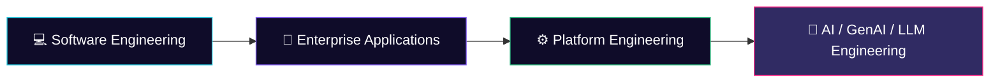

<!-- ============================================================
  SETUP: Find & replace  YOUR_USERNAME  with your GitHub username.
  (Profile README lives in a repo named exactly like your username.)
============================================================ -->

<div align="center">


<a href="https://git.io/typing-svg">
  
</a>

<br/>


[](https://linkedin.com/in/YOUR_LINKEDIN)
[](mailto:YOUR_EMAIL)
[](https://YOUR_PORTFOLIO)

</div>

---

## 👋 About Me

```text
> whoami
  Software Engineer — AI & Cloud-Native Systems

> specialty
  Real-time AI apps · LLMs · GenAI · RAG · NLP · AI Agents

> background
  Enterprise software · React · Python · Kubernetes · Docker · CI/CD

> mission
  Turn emerging AI concepts into practical, scalable systems.
```

> 🚀 **Build → Learn → Experiment → Ship**

---

## 🔭 Current Focus

| | Focus Area | Status |
|---|---|---|
| 🤖 | Real-time AI & GenAI applications |  |
| 🧠 | LLMs, RAG, NLP & AI Agents |  |
| ☁️ | AWS & cloud-native architecture |  |
| ⚙️ | Kubernetes & Terraform platforms |  |
| 🧩 | Platform Engineering & Developer Platforms |  |

---

## 🛠️ Tech Stack

**Languages**<br/>


**Frontend**<br/>


**Backend**<br/>


**Cloud & DevOps**<br/>


**Platform Engineering & Observability**<br/>


**AI / GenAI**<br/>


**Data**<br/>


**Testing & Quality**<br/>


---

## 📈 Learning Progress

| Skill | Progress |
|---|---|
| 🤖 LLMs & GenAI |  |
| 🔎 RAG & Vector Databases |  |
| 🧠 AI Agents |  |
| ☁️ AWS & Cloud-Native |  |
| ⚙️ Kubernetes & Terraform |  |
| 🧩 Platform Engineering |  |

> Adjust the number in each URL (`/75/`) to match your real progress.

---

## 📊 GitHub Stats

<div align="center">


</div>

---

## 🏆 Trophies

<div align="center">
  
</div>

---

## 🧭 Engineering Journey



---

## 🐍 Contribution Snake

<div align="center">
  
</div>

<sub>Requires the [Platane/snk](https://github.com/Platane/snk) GitHub Action — see setup notes below.</sub>

---

## 🤝 Let's Connect

I'm open to collaborating on **AI, GenAI and cloud-native** projects. Reach out if you'd like to build something together.

<div align="center">


</div>

<!--
============================================================
SNAKE ANIMATION SETUP (optional)
Create .github/workflows/snake.yml in this repo:

name: Generate Snake
on:
  schedule: [{ cron: "0 */12 * * *" }]
  workflow_dispatch:
permissions:
  contents: write
jobs:
  generate:
    runs-on: ubuntu-latest
    steps:
      - uses: Platane/snk/svg-only@v3
        with:
          github_user_name: ${{ github.repository_owner }}
          outputs: dist/github-snake-dark.svg?palette=github-dark
      - uses: crazy-max/ghaction-github-pages@v3.1.0
        with:
          target_branch: output
          build_dir: dist
        env:
          GITHUB_TOKEN: ${{ secrets.GITHUB_TOKEN }}
============================================================
-->
